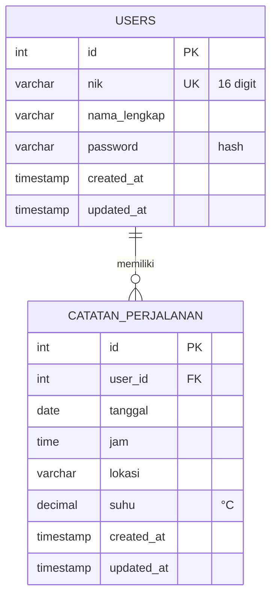

# Rancangan Struktur Database — Peduli Diri

|                  |                                                                |
| ---------------- | -------------------------------------------------------------- |
| Versi            | 1.0 — Draf                                                     |
| Tanggal          | 2026-10-18                                                     |
| DBMS             | MySQL 5.7+ / MariaDB 10.3+                                     |
| File DDL siap pakai | [`database.sql`](../database.sql)                           |
| Dokumen terkait  | [PRD](PRD.md), [README](../README.md)                          |

---

## 1. Ringkasan

Saat ini aplikasi **tidak memakai database** — data tersimpan di dua file teks:

| File lama  | Isi                          | Menjadi tabel            |
| ---------- | ---------------------------- | ------------------------ |
| `config.txt`  | `NIK\|NAMA_LENGKAP` per baris | **`users`** (fitur login) |
| `catatan.txt` | `ID\|NIK\|NAMA\|TANGGAL\|JAM\|LOKASI\|SUHU` | **`catatan_perjalanan`** |

Fokus rancangan ini adalah **fitur login**: menggantikan kombinasi _NIK + Nama Lengkap_ (yang saat ini **tanpa password**) menjadi autentikasi **NIK + Password** yang ter-hash.

## 2. Keputusan Desain

| #   | Keputusan                              | Alasan                                                                                                                                                            |
| --- | -------------------------------------- | ----------------------------------------------------------------------------------------------------------------------------------------------------------------- |
| K1  | MySQL / MariaDB                        | Standar stack PHP di Laragon/XAMPP, murah dan tersedia di hampir semua shared hosting.                                                                             |
| K2  | Login **NIK + password**               | NIK sudah menjadi identitas utama aplikasi; tinggal menambahkan password — tanpa perlu kolom email baru.                                                           |
| K3  | `nik VARCHAR(16) UNIQUE`               | NIK KTP berjumlah 16 digit; **VARCHAR** agar nol di depan tidak hilang (angka numerik akan menghapusnya) dan mendukung validasi format.                             |
| K4  | `password VARCHAR(255)`                | Menampung hash bcrypt/argon2id hasil `password_hash()`. Teks asli password **tidak pernah** disimpan.                                                              |
| K5  | InnoDB + `utf8mb4_unicode_ci`          | Mendukung Foreign Key dan seluruh karakter Unicode (nama lokal, emoji).                                                                                            |
| K6  | Relasi `user_id` (1:N)                 | Menggantikan pencocokan string `NIK\|NAMA` yang rapuh dan mahal (seluruh file dibaca pada setiap request).                                                          |
| K7  | `id AUTO_INCREMENT`                    | Menggantikan `rand(0, 100000)` pada `simpan_catatan.php` yang **rawan bentrok** (bukan unique).                                                                     |
| K8  | `suhu DECIMAL(4,1)` nullable           | Menyeragamkan satuan ke °C. Data lama berformat bebas (`"11 c"`, `"13KELVIN"`, `"20^C"`) perlu dibersihkan saat migrasi — lihat bagian 6.                            |

## 3. Diagram Relasi (ERD)



## 4. Detail Tabel

### 4.1 `users` — inti fitur login

| Kolom          | Tipe            | Null | Kunci | Keterangan                                       |
| -------------- | --------------- | ---- | ----- | ------------------------------------------------ |
| `id`           | INT UNSIGNED    | No   | PK    | Auto increment.                                  |
| `nik`          | VARCHAR(16)     | No   | UNIQUE| NIK 16 digit; divalidasi di aplikasi (16 angka).  |
| `nama_lengkap` | VARCHAR(100)    | No   | —     | Nama sesuai KTP/dokumen.                         |
| `password`     | VARCHAR(255)    | No   | —     | Hasil `password_hash()` (bcrypt/argon2id).       |
| `created_at`   | TIMESTAMP       | No   | —     | Waktu pendaftaran (UTC).                         |
| `updated_at`   | TIMESTAMP       | No   | —     | Diperbarui otomatis.                             |

### 4.2 `catatan_perjalanan`

| Kolom       | Tipe             | Null | Kunci | Keterangan                                        |
| ----------- | ---------------- | ---- | ----- | ------------------------------------------------- |
| `id`        | INT UNSIGNED     | No   | PK    | Auto increment (pengganti `rand()`).              |
| `user_id`   | INT UNSIGNED     | No   | FK    | → `users.id`, `ON DELETE CASCADE`.                |
| `tanggal`   | DATE             | No   | —     | Tanggal perjalanan.                               |
| `jam`       | TIME             | No   | —     | Jam perjalanan.                                   |
| `lokasi`    | VARCHAR(150)     | No   | —     | Nama/tempat lokasi.                               |
| `suhu`      | DECIMAL(4,1)     | Ya   | —     | Suhu tubuh dalam °C; `NULL` bila tidak diisi.     |
| `created_at`| TIMESTAMP        | No   | —     | Waktu catatan dibuat.                             |
| `updated_at`| TIMESTAMP        | No   | —     | Diperbarui otomatis saat diubah.                  |

**Indeks:** `idx_catatan_user_tanggal (user_id, tanggal)` — mempercepat daftar catatan per pengguna yang diurutkan tanggal.

> Validasi rentang suhu (30.0–45.0 °C) dilakukan di **lapisan aplikasi**, bukan `CHECK` constraint, agar kompatibel dengan MySQL 5.7.

## 5. Skema SQL

DDL lengkap dan siap dijalankan tersedia di [`database.sql`](../database.sql). Ringkasannya:

```sql
CREATE DATABASE IF NOT EXISTS peduli_diri
    CHARACTER SET utf8mb4 COLLATE utf8mb4_unicode_ci;

USE peduli_diri;

CREATE TABLE users (
    id            INT UNSIGNED NOT NULL AUTO_INCREMENT,
    nik           VARCHAR(16)  NOT NULL,
    nama_lengkap  VARCHAR(100) NOT NULL,
    password      VARCHAR(255) NOT NULL,
    created_at    TIMESTAMP    NOT NULL DEFAULT CURRENT_TIMESTAMP,
    updated_at    TIMESTAMP    NOT NULL DEFAULT CURRENT_TIMESTAMP ON UPDATE CURRENT_TIMESTAMP,
    PRIMARY KEY (id),
    UNIQUE KEY uq_users_nik (nik)
) ENGINE=InnoDB DEFAULT CHARSET=utf8mb4 COLLATE=utf8mb4_unicode_ci;

CREATE TABLE catatan_perjalanan (
    id         INT UNSIGNED NOT NULL AUTO_INCREMENT,
    user_id    INT UNSIGNED NOT NULL,
    tanggal    DATE         NOT NULL,
    jam        TIME         NOT NULL,
    lokasi     VARCHAR(150) NOT NULL,
    suhu       DECIMAL(4,1) NULL,
    created_at TIMESTAMP    NOT NULL DEFAULT CURRENT_TIMESTAMP,
    updated_at TIMESTAMP    NOT NULL DEFAULT CURRENT_TIMESTAMP ON UPDATE CURRENT_TIMESTAMP,
    PRIMARY KEY (id),
    KEY idx_catatan_user_tanggal (user_id, tanggal),
    CONSTRAINT fk_catatan_users FOREIGN KEY (user_id)
        REFERENCES users (id) ON DELETE CASCADE
) ENGINE=InnoDB DEFAULT CHARSET=utf8mb4 COLLATE=utf8mb4_unicode_ci;
```

**Cara menjalankan:**

```bash
mysql -u root -p < database.sql
```

atau import melalui phpMyAdmin.

## 6. Pemetaan Migrasi Data Lama

### 6.1 `config.txt` → `users`

| Data lama               | Kolom tujuan     | Catatan                                                                                     |
| ----------------------- | ---------------- | ------------------------------------------------------------------------------------------- |
| bagian 1 baris (`NIK`)  | `nik`            | Cek duplikat dan format 16 digit sebelum insert; baris **header** (`NIK \| NAMA LENGKAP`) harus dilewati. |
| bagian 2 baris (`NAMA`) | `nama_lengkap`   | `TRIM()` setiap nilai.                                                                      |
| _tidak ada_             | `password`       | **Masalah utama**: data lama tidak punya password. Buat password sementara yang sudah di-hash, lalu wajibkan pengguna menggantinya — atau minta daftar ulang. |

Membuat hash password via PHP CLI:

```bash
php -r "echo password_hash('password-anda', PASSWORD_DEFAULT), PHP_EOL;"
```

### 6.2 `catatan.txt` → `catatan_perjalanan`

| Kolom lama     | Kolom tujuan    | Catatan                                                                 |
| -------------- | --------------- | ----------------------------------------------------------------------- |
| `ID_CATATAN`   | `id`            | Pertahankan **hanya bila unik**; selain itu biarkan auto increment.       |
| `NIK`          | `user_id`       | Lookup ke tabel `users` (join berdasarkan `nik`).                       |
| `NAMA_LENGKAP` | _dihapus_       | Redundan — sudah tersimpan di `users`; jangan disimpan ganda.           |
| `TANGGAL`      | `tanggal`       | Pastikan format `YYYY-MM-DD`.                                           |
| `JAM`          | `jam`           | Samakan ke `HH:MM:SS`.                                                  |
| `LOKASI`       | `lokasi`        | `TRIM()`, maksimal 150 karakter.                                        |
| `SUHU`         | `suhu`          | **Perlu dibersihkan** — data nyata berformat bebas: `"11 c"`, `"13KELVIN"`, `"20^C"`, `"16"`. Ekstrak angkanya; bila tidak terbaca → `NULL`. |

**Peringatan:**

- Baris pertama kedua file adalah **header**, bukan data — jangan ikut diimpor.
- Jangan mengimpor bila NIK pada `catatan.txt` tidak ditemukan di `config.txt` (data yatim) — audit dulu.
- Setelah migrasi selesai dan diverifikasi, file teks lama **jangan di-commit**; tetap masuk `.gitignore`.

## 7. Keamanan & Operasional

- Gunakan **prepared statements** (PDO) untuk semua query — jangan pernah mencampur variabel request ke dalam string SQL.
- Password hanya lewat `password_hash()` / `password_verify()`.
- Di UI, tampilkan NIK sebagian saja (mis. `1234******3456`) dan jangan pernah melewatkan NIK lewat parameter URL.
- Kredensial database tidak boleh ada di repo — simpan di file konfigurasi lokal / `.env` (masuk `.gitignore`).
- Backup terjadwal, contoh: `mysqldump peduli_diri > backup_$(date +%F).sql` — dan **uji restore**-nya.
- Selama masa transisi, `config.txt` & `catatan.txt` tetap masuk `.gitignore` (berisi data pribadi).

## 8. Pengembangan Lanjutan (di luar v1.0)

| Ide                                       | Manfaat                                                        |
| ----------------------------------------- | -------------------------------------------------------------- |
| `users.email` + `reset_token` + `reset_expires` | Lupa password via email.                                  |
| Tabel `login_attempts` (`ip`, `nik`, `attempted_at`) | Rate-limiting login yang bertahan lintas sesi.       |
| Tabel `sessions`                          | Sesi lintas-perangkat & rekam jejak aktivitas login.           |
| `users.role`                              | Peran admin/pengawas untuk rekapitulasi data banyak pengguna.  |

## 9. Checklist Implementasi

- [ ] Jalankan `database.sql` dan verifikasi tabel terbuat.
- [ ] Buat lapisan koneksi DB (PDO) dengan kredensial di luar repositori.
- [ ] Form registrasi → `INSERT INTO users` dengan password ter-hash.
- [ ] Form login → `SELECT ... WHERE nik = ?` + `password_verify()`.
- [ ] CRUD catatan → tabel `catatan_perjalanan`, selalu dengan `WHERE user_id = ?`.
- [ ] Skrip migrasi data lama + laporan baris yang disisihkan.
- [ ] Perbaiki tautan logout (`logout.php` dengan `session_destroy`).
- [ ] Uji regresi seluruh alur, lalu hentikan penulisan file teks.
